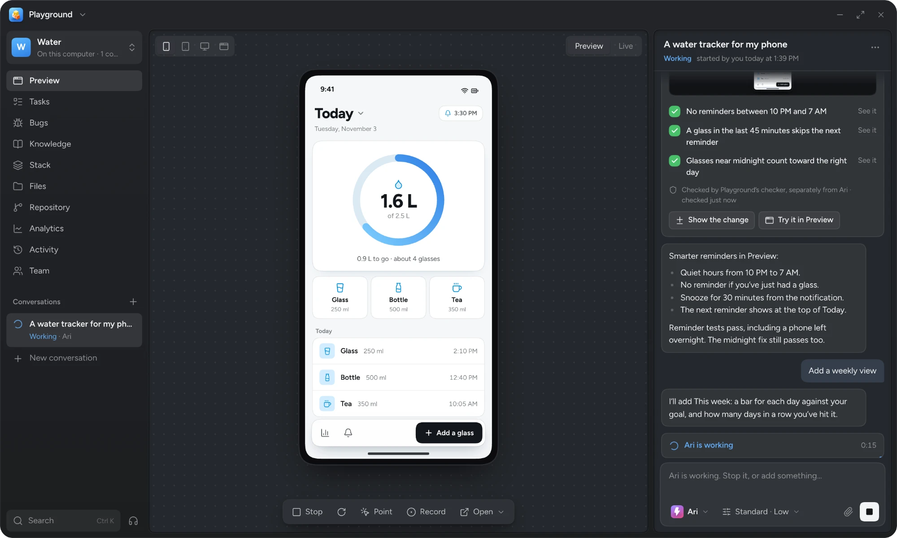

# Playground

An agentic development environment for Luma. Describe what you want to make; Playground creates a real
project folder, connects an agent of your choice, and shows the running app in a live preview at phone,
tablet and desktop sizes while the agent works.



## Install on Luma

Playground runs as an ordinary program of your user account, not in a sandbox: it starts agents, a
container per project for build tools, and previews of the apps you make, all against your system. Install
it with one of the commands below rather than by opening a downloaded package in Software.

### For your account (no reboot)

```sh
curl -LO https://github.com/SimplyLuma/Playground/releases/latest/download/playground.tar.gz
tar -xzf playground.tar.gz
cd playground
./install.sh
```

Playground appears in your apps. It installs under `~/.local` and needs no administrator password. To
update, download the latest release and run `./install.sh` again. To remove it, run `./uninstall.sh`;
your projects in `~/Documents/Playground Projects` stay.

### As a system package

```sh
curl -LO https://github.com/SimplyLuma/Playground/releases/latest/download/luma-playground.noarch.rpm
rpm-ostree install ./luma-playground.noarch.rpm
systemctl reboot
```

This layers the RPM onto the system image. It requires Luma's platform package
(`luma-developer-platform`), which Luma already includes.

## First start

With no agent connected, Playground offers:

- **Use your ChatGPT plan**: Continue with ChatGPT signs in through OpenAI in your browser; Ari, Luma's
  agent, then runs on your plan.
- **Use your Claude plan**: Claude Code, signed in with your Claude account.
- **A model on this computer**: a model sized to your computer's memory, through Ollama.
- **Other ways**: an API key (Anthropic, OpenAI, Google), Gemini CLI, OpenCode, goose, or another account.

## What it does

- **Projects are plain folders.** Each has the code, an `AGENTS.md`, and `.playground/` with tasks, bugs,
  knowledge, a journal and a `now.md` summary, so any agent can pick up the work without the app.
- **Agents over the Agent Client Protocol.** Ari, Codex, Claude Code, Gemini CLI, OpenCode and goose run
  through their own sign-in, fenced to the project folder. Playground's MCP server (`playground-mcp`) gives
  them tasks, bugs, knowledge, decisions for you to answer, screenshots and checks.
- **Live preview.** Websites, and GTK apps through GTK's Broadway backend. A desktop app shown at phone
  size runs as it would on a Luma phone (full screen, Luma's handheld presentation), on a private session
  bus. Changes restart the app.
- **A box per project.** Build tools and libraries install into a podman container that sees only the
  project folder, never into your system.
- **Sharing.** Teammates sync through a project home over SSH with short-lived certificates; project
  secrets live in an end-to-end encrypted vault.

## Requirements

- Luma (Fedora 44 based), or Fedora 44 with `luma-developer-platform`
- Python 3.11 or newer, PyGObject, GTK 4.18+, libadwaita 1.7+, WebKitGTK 6.0, GtkSourceView 5, VTE for GTK 4
- `gtk4-broadwayd` for previews of desktop apps
- podman for project boxes; git, openssh, bubblewrap
- Node.js 22+ for some agent adapters (Playground downloads its own copy when there is none)

## Run from source

```sh
git clone https://github.com/SimplyLuma/Playground
cd Playground
python3 -m luma_playground
```

Tests: `python3 -m unittest discover -s tests`. Tests that need a display skip without one.

## Documentation

- [ARCHITECTURE.md](ARCHITECTURE.md): modules, file formats and contracts
- [SECURITY.md](SECURITY.md): agent fencing, secrets, certificates and the vault
- [SHARING.md](SHARING.md): how teammates' copies of a project stay in sync
- [packaging/luma-playground.spec](packaging/luma-playground.spec): the RPM

## License

Apache-2.0 ([LICENSE](LICENSE)). Icon geometry from Lucide, ISC ([data/icons/LUCIDE-LICENSE](data/icons/LUCIDE-LICENSE)).
Provider marks use Simple Icons paths, CC0 ([data/marks/README.md](data/marks/README.md)).
